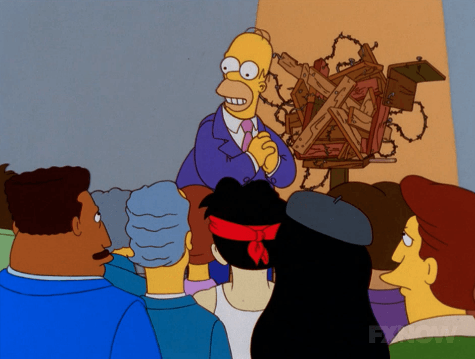
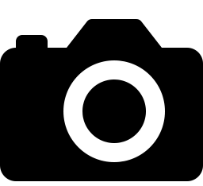

:::: {.columns}

::: {.column width="47.5%"}
{style="float: left;vertical-align:middle;
margin:10px 20px;border-radius: 10px;"}
:::

::: {.column width="5%"}
<!-- empty column to create gap -->
:::

::: {.column width="47.5%"}
<div style="text-align: right"> <p>&quot;<em>Dice che molte volte dovrei stare zitto<br>perché parlo senza aver sudato.<br>
E le altre volte dovrei stare zitto<br>perché parlo senza aver studiato.</em>&quot; <br> La mia donna dice che - D. D'Amico - [Translation](https://translate.google.com/?sl=origin_language_or_auto&tl=en&text=%20La%20mia%20donna%20dice%20che%20molte%20volte%20dovrei%20stare%20zitto%20perch%C3%A9%20parlo%20senza%20aver%20sudato.%20%20E%20le%20altre%20volte%20dovrei%20stare%20zitto%20perch%C3%A9%20parlo%20senza%20aver%20studiato.&op=translate)</p>
</div>
:::
::::


# Talks and Posters


```{r, echo = FALSE, message = FALSE, warning = FALSE}
library(tidyverse)
library(leaflet)
library(htmltools)

# ---- Data -------------------------------------------------------------------
# type: plenary | presentation (invited talk) | talk (contributed) | poster |
#       seminar | attended (other conferences and workshops)
# Rows without coordinates (virtual events) are not drawn on the map.
df <- tribble(
  ~event, ~title, ~city, ~country, ~lon, ~lat, ~type, ~year, ~month, ~link,

  # ---- 2026 ----
  "Non-Clinical Statistics Conference NCS 2026", "Bayesian Nonparametrics Methods for Complex Biomedical Data", "Padua", "Italy", 11.8925, 45.4127, "plenary", 2026, 9, "https://ncs-conference.org",
  "COMPSTAT 2026", "Bayesian nonparametric priors and discrete random structures for high-dimensional biological inference", "Athens", "Greece", 23.7335, 37.9818, "presentation", 2026, 8, "https://www.compstat2026.org",
  "ISBA World Meeting 2026", "Bayesian Multiresolution Functional Regression and Clustering via stCUSP", "Nagoya", "Japan", 136.88659, 35.17065, "poster", 2026, 6, "https://isba2026.github.io",
  "BAYSM 2026", "Bayesian Multiresolution Functional Regression and Clustering via stCUSP", "Chiba", "Japan", 140.1031, 35.6278, "presentation", 2026, 6, "https://baysm2026.github.io",
  "Nordstat 2026", "Bayesian Multiresolution Functional Regression and Clustering via stCUSP", "Helsinki", "Finland", 25.04655, 60.200186, "presentation", 2026, 6, "https://www.helsinki.fi/en/conferences/nordstat-2026",
  "GLASS informal seminar series", "An informal intro to BNP mixture models", "Padua", "Italy", 11.883828, 45.404456, "seminar", 2026, 4, "https://sites.google.com/view/laboratoriodistatisticasociale/appuntamenti-online?authuser=0",

  # ---- 2025 ----
  "SISBayes 2025", "BNP4BNP: Bayesian Nonparametric Models for Biomarkers and Neuronal Patterns", "Padua", "Italy", 11.883828, 45.404456, "presentation", 2025, 9, "https://sisbayes2025.stat.unipd.it",
  "BNP 14", "BNP4BNP: Bayesian Nonparametric Models for Biomarkers and Neuronal Patterns", "Los Angeles", "United States", -118.44455, 34.07062, "presentation", 2025, 6, "https://bnp14.org",
  "Early-Career Workshop on Nonparametric Statistics", "Bayesian nonparametric models for biomarkers and neuronal patterns", "Rome", "Italy", 12.4676, 41.9225, "presentation", 2025, 5, "https://sites.google.com/view/wsnpstats",
  "DAIS Seminar Series", "BNP4BNP: Bayesian Nonparametric Models for Biomarkers and Neuronal Patterns", "Mestre", "Italy", 12.254767, 45.478127, "seminar", 2025, 4, "https://www.unive.it/pag/16129/",

  # ---- 2024 ----
  "Frontiers of Bayesian Inference and Data Science", "Of mice and music: finite-infinite nested priors for the segmentation of large-scale grouped data", "Oaxaca", "Mexico", -96.72365, 17.06542, "presentation", 2024, 9, "https://www.birs.ca/events/2024/5-day-workshops/24w5196/schedule",
  "UniPD Welcome Seminar", "Of mice and music: finite-infinite nested priors for the segmentation of large-scale grouped data", "Padua", "Italy", 11.883828, 45.404456, "seminar", 2024, 11, "https://www.linkedin.com/feed/update/urn:li:activity:7259643658784669697/",
  "ISBA Satellite workshop to ISBA World Meeting", "Segmenting brain imaging mass spectrometry data under separate exchangeability", "Lugano", "Switzerland", 8.96004, 46.01008, "presentation", 2024, 6, "https://www.usi.ch/en/feeds/25999",
  "ISBA World Meeting 2024", "Finite-infinite nested priors for the segmentation of complex, large-scale grouped datasets", "Venice", "Italy", 12.3155, 45.4408, "poster", 2024, 7, "https://www.unive.it/web/en/2208/home",

  # ---- 2023 ----
  "CFE-CMStatistics 2023", "Bayesian models and computational methods for complex biological and environmental datasets", "Berlin", "Germany", 13.404954, 52.520008, "presentation", 2023, 12, "https://www.cmstatistics.org/CMStatistics2023/programme.php",
  "SIS 2023", "Bayesian analysis of Amazon's best-selling books via finite nested mixture models", "Ancona", "Italy", 13.5150, 43.6158, "talk", 2023, 6, "https://meetings3.sis-statistica.org/index.php/ancona/ancona",
  "BAYSM 2023", "Segmenting MALDI-MSI brain imaging mass spectrometry data under separate exchangeability", "Online", "Virtual", NA, NA, "talk", 2023, 11, "https://events.stat.uconn.edu/BAYSM2023/",

  # ---- 2022 ----
  "CFE-CMStatistics 2022 (Ercim)", "Multiple hypothesis screening via mixtures of non-local distributions with applications to genomic datasets", "London", "United Kingdom", -0.118092, 51.509865, "presentation", 2022, 12, "http://www.cmstatistics.org/CMStatistics2022/index.php",
  "ISBA World Meeting 2022", "Bayesian screening via mixtures of shrinkage priors with applications to light-sheet fluorescence microscopy in brain imaging", "Montreal", "Canada", -73.561668, 45.508888, "presentation", 2022, 6, "https://isbawebmaster.github.io/ISBA2022/",
  "SIS 2022", "Clustering artists based on the energy distributions of their songs on Spotify via the Common Atoms Model", "Caserta", "Italy", 14.33333, 41.066666, "presentation", 2022, 6, "https://meetings3.sis-statistica.org/index.php/SIS2022/Caserta",
  # The contributed SIS 2022 talk listed below was commented out in your data (same city and month):
  # "SIS 2022", "A tool to validate the assumptions on ratios of nearest neighbors' distances: the Consecutive Ratio Paths", "Caserta", "Italy", 14.3265, 41.0747, "talk", 2022, 6, "https://meetings3.sis-statistica.org/index.php/SIS2022/Caserta",
  "CSUEB ASA Student Chapter", "Bayesian nonparametric mixtures for novelty detection", "Hayward", "United States", -122.080795, 37.668819, "seminar", 2022, 10, "https://www.instagram.com/asacsueb/",
  "Cattolica - Spring 22 Seminar Series", "Bayesian nonparametric mixtures for novelty detection and partially exchangeable data", "Milan", "Italy", 9.18854, 45.464664, "seminar", 2022, 4, "https://dipartimenti.unicatt.it/scienze-statistiche-dipartimento-di-scienze-statistiche-eventi#content",

  # ---- 2021 ----
  "EcoSta 2021", "Horseshoe Pit -- A Unified Framework for Large-Scale Bayesian Inference", "Online", "Virtual", NA, NA, "presentation", 2021, 6, "http://www.cmstatistics.org/EcoSta2021/index.php",
  "Joint Statistical Meeting 2021", "Detecting Brain Activation via Bayesian Mixture of Horseshoe Distributions", "Virtual", "United States", NA, NA, "talk", 2021, 8, "https://ww2.amstat.org/meetings/jsm/2021/",
  "ISBA World Meeting 2021", "Bayesian Variable Selection via Mixture of Horseshoe Distributions", "Virtual", "United States", NA, NA, "talk", 2021, 6, "https://events.stat.uconn.edu/ISBA2021/",

  # ---- 2020 ----
  "UCI - Fall 2020 Seminar Series", "Bayesian Sparse Regression via Cluster Shrinkage Parameters", "Irvine", "United States", -117.823059, 33.669445, "seminar", 2020, 11, "https://www.stat.uci.edu/seminar-series/",
  "Bayes Comp 2020", "Bayesian nonparametric dimensionality reduction via estimation of data intrinsic dimensions", "Gainesville", "United States", -82.3248, 29.6516, "talk", 2020, 1, "http://users.stat.ufl.edu/~jhobert/BayesComp2020/Conf_Website",
  "Models and Learning for Clustering and Classification", "Bayesian Nonparametric Functional Novelty Detector", "Online", "Virtual", NA, NA, "poster", 2020, 9, "http://mbc2.unict.it/",
  "Young-ISA Twitter Poster Conference (#YISAPoster2020)", "A Two-Stage Bayesian Nonparametric Model for Novelty Detection with Robust Prior Information", "Online", "Virtual", NA, NA, "poster", 2020, 7, "https://young-istat.github.io/events/posts/2020-07-15-poster-conference-2020",

  # ---- 2019 ----
  "12th IBS-Italian Region Conference", "Modeling Human Microbiome Data via Latent Nested Nonparametric Priors", "Naples", "Italy", 14.2681, 40.8518, "talk", 2019, 7, "https://ibs-italy.org/?page_id=922&lang=en",
  "BNP 12 - Bayesian Nonparametrics", "Modeling Human Microbiome Data via Latent Nested Nonparametric Priors", "Oxford", "United Kingdom", -1.2550, 51.7548, "poster", 2019, 6, "https://www.stats.ox.ac.uk/bnp12/",

  # ---- Other conferences and workshops (attended) ----
  "Rethinking the Role of Bayesianism in the Age of Modern AI", NA, "Edinburgh", "United Kingdom", -3.1883, 55.9533, "attended", 2026, 10, "https://workshops.inf.ed.ac.uk/ml/bayesai/",
  "Skew 2026 - A class of distributions which includes the normal one", NA, "Padua", "Italy", 11.883828, 45.404456, "attended", 2026, 1, "https://skew2026.stat.unipd.it",
  "Uncertainty, Bayes and Statistics - A meeting in honor of Guido Consonni", NA, "Milan", "Italy", 9.18854, 45.464664, "attended", 2024, 7, "https://dipartimenti.unicatt.it/scienze-statistiche-seminari-eventi-uncertainty-bayes-and-statistics-a-meeting-in-honour-of-guido-consonni",
  "Statalk 2023", NA, "Rome", "Italy", 12.4676, 41.9225, "attended", 2023, 9, "https://statalk2023.shinyapps.io/statalk2023/",
  "Bayesian Nonparametrics for Complex Data", NA, "Padua", "Italy", 11.883828, 45.404456, "attended", 2020, 1, "http://bnp4cd.stat.unipd.it/workshop.html",
  "Network Models in Statistics, Economics and Social Sciences", NA, "Milan", "Italy", 9.18854, 45.464664, "attended", 2019, 11, "https://www.eventbrite.it/e/network-models-in-statistics-economics-and-social-registration-59152695304",
  "Statistical Methods in Imaging - SMI 2019", NA, "Irvine", "United States", -117.823059, 33.669445, "attended", 2019, 6, "https://sites.uci.edu/smi2019/",
  "FoMICS-DADSi Summer School on Data Assimilation", NA, "Lugano", "Switzerland", 8.96004, 46.01008, "attended", 2018, 9, "https://www.ics.usi.ch/index.php/news/285-fomics-dadsi-summer-school-on-data-assimilation",
  "LMS Invited Lecture Series and CRiSM Summer School in Computational Statistics 2018", NA, "Warwick", "United Kingdom", -1.5615, 52.3793, "attended", 2018, 7, "https://warwick.ac.uk/fac/sci/statistics/crism/workshops/lms2018/",
  "ISBA World Meeting 2018", NA, "Edinburgh", "United Kingdom", -3.1883, 55.9533, "attended", 2018, 6, "https://bayesian.org/isba2018/"
)

# ---- Prep -------------------------------------------------------------------
type_levels <- c("plenary", "presentation", "talk", "poster", "seminar", "attended")
type_labels <- c(plenary      = "Plenary talk",
                 presentation = "Invited talk",
                 talk         = "Contributed talk",
                 poster       = "Poster",
                 seminar      = "Invited seminar",
                 attended     = "Attended (other conferences)")
type_cols   <- c(plenary = "#c77dff", presentation = "#e63946", talk = "#ffb703",
                 poster = "#06d6a0", seminar = "#4cc9f0", attended = "#9aa0a6")

yr <- range(df$year)

df <- df |>
  mutate(
    type  = factor(type, levels = type_levels),
    when  = paste(month.abb[month], year),
    # past/older events are drawn smaller; attended events smaller still
    radius = if_else(type == "attended",
                     scales::rescale(year, to = c(4, 8),  from = yr),
                     scales::rescale(year, to = c(6, 12), from = yr)),
    popup = paste0(
      "<div style='font-family:sans-serif;max-width:260px'>",
      "<b>", event, "</b><br>",
      "<span style='color:#888'>", type_labels[as.character(type)], " &middot; ", when, "</span><br>",
      if_else(is.na(title), "", paste0("<i>", title, "</i><br>")),
      city, ", ", country, "<br>",
      "<a href='", link, "' target='_blank'>event page</a></div>"
    )
  )

mapped  <- df |> filter(!is.na(lat), !is.na(lon))
virtual <- df |> filter(is.na(lat) | is.na(lon))

# ---- Map (dark basemap from plain OSM tiles, inverted with CSS) -------------
m <- leaflet(mapped, height = 520,
             options = leafletOptions(minZoom = 2, worldCopyJump = TRUE)) |>
  addTiles(options = tileOptions(className = "dark-tiles")) |>
  htmlwidgets::prependContent(tags$style(
    ".dark-tiles { filter: invert(100%) hue-rotate(180deg) brightness(95%) contrast(90%); }"
  ))

# one toggleable layer per type
for (t in type_levels) {
  d <- filter(mapped, type == t)
  m <- m |>
    addCircleMarkers(
      data = d, lng = ~lon, lat = ~lat, radius = ~radius,
      color = "white", weight = 1,
      fillColor = type_cols[[t]], fillOpacity = 0.9,
      popup = ~popup, label = ~paste0(event, " (", year, ")"),
      group = type_labels[[t]],
      clusterOptions = markerClusterOptions(showCoverageOnHover = FALSE,
                                            spiderfyOnMaxZoom = TRUE)
    )
}

n_own <- sum(df$type != "attended")
n_att <- sum(df$type == "attended")

m |>
  addLegend("bottomleft", colors = unname(type_cols), labels = unname(type_labels),
            title = "Type", opacity = 0.9) |>
  addLayersControl(overlayGroups = unname(type_labels),
                   options = layersControlOptions(collapsed = TRUE)) |>
  addControl(
    html = paste0("<b>", n_own, " talks, seminars &amp; posters</b><br>",
                  n_att, " other events attended &middot; ",
                  n_distinct(mapped$city), " cities<br>",
                  "<small>", nrow(virtual), " virtual events not shown</small>"),
    position = "topright"
  )
```

A visual summary of talks, posters and attended events, built with the [leaflet](https://rstudio.github.io/leaflet/) package.

## Plenary Talks

- [Non-Clinical Statistics Conference NCS 2026](https://ncs-conference.org/)  
Talk: *Bayesian Nonparametrics Methods for Complex Biomedical Data*  
Padua, IT - September 2026 - [  ](../img_pag/PLE_NCS2026.qmd)

## Invited Talks

<!---
- [BAYMS 2026](https://)  
Talk: **  
Tokyo, JAP - June 2026 - [  ](../img_pag/INV_BAYSM26.qmd)
--->


- [COMPSTAT 2026](https://www.compstat2026.org/)  
Talk: *Bayesian nonparametric priors and discrete random structures for high-dimensional biological inference*  
Athens, GR - August 2026 - [  ](../img_pag/INV_COMPSTAT26.qmd)


- [[BAYSM 2026]{.fix}](https://baysm2026.github.io)  
Talk: *Bayesian Multiresolution Functional Regression and Clustering via stCUSP*  
Chiba, JP - June 2026 - [  ](../img_pag/INV_BAYSM26.qmd)


- [Nordstat 2026](https://www.helsinki.fi/en/conferences/nordstat-2026)  
Talk: *Bayesian Multiresolution Functional Regression and Clustering via stCUSP*  
Helsinki, FI - June 2026 - [  ](../img_pag/INV_Hels26.qmd)

- [SISBayes 2025](https://sisbayes2025.stat.unipd.it)  
Talk: *BNP4BNP: Bayesian Nonparametric Models for Biomarkers and Neuronal Patterns*  
Padua, IT - September 2025 - [  ](../img_pag/INV_Padua25.qmd)

- [BNP 14](https://bnp14.org)  
Talk: *BNP4BNP: Bayesian Nonparametric Models for Biomarkers and Neuronal Patterns*  
Los Angeles, US - June 2025 - [  ](../img_pag/INV_LosAngeles25.qmd)


- [Early-Career Workshop on Nonparametric Statistics](https://sites.google.com/view/wsnpstats)  
Talk: *Bayesian nonparametric models for biomarkers and neuronal patterns*  
Rome, IT - May 2025 - [  ](../img_pag/INV_Rome25.qmd)


- [Frontiers of Bayesian Inference and Data Science](https://www.birs.ca/events/2024/5-day-workshops/24w5196/schedule)  
Talk: *Of mice and music: finite-infinite nested priors for the segmentation of large-scale grouped data*  
Oaxaca, MX - September 2024 - [  ](../img_pag/INV_Oaxaca24.qmd)

- [ISBA Satellite workshop to ISBA World Meeting](https://www.usi.ch/en/feeds/25999)  
Talk: *Segmenting brain imaging mass spectrometry data under separate exchangeability*  
Lugano, CH - June 2024 - [  ](../img_pag/INV_Lugano24.qmd)

- [CFE-CMStatistics 2023](https://www.cmstatistics.org/CMStatistics2023/programme.php)  
Virtual talk: *Bayesian models and computational methods for complex biological and environmental datasets*  
Berlin, DE - December 2023 - [  ](../img_pag/INV_Berlin23.qmd)

- [CFE-CMStatistics 2022 (Ercim)](http://www.cmstatistics.org/CMStatistics2022/index.php)  
Virtual talk: *Multiple hypothesis screening via mixtures of non-local distributions with applications to genomic datasets*  
London, UK - December 2022 - [  ](../img_pag/INV_CMStat_Virtual22.qmd)

- [ISBA World Meeting 2022](https://isbawebmaster.github.io/ISBA2022/)  
j-ISBA session talk: *Bayesian screening via mixtures of shrinkage priors with applications to light-sheet fluorescence microscopy in brain imaging*  
Montreal, CA - June 2022 - [  ](../img_pag/INV_Montreal22.qmd)

- [SIS 2022](https://meetings3.sis-statistica.org/index.php/SIS2022/Caserta)  
Talk: *Clustering artists based on the energy distributions of their songs on Spotify via the Common Atoms Model*    
Caserta, IT - June 2022 - [  ](../img_pag/INV_Caserta22.qmd)

- [EcoSta 2021](http://www.cmstatistics.org/EcoSta2021/index.php)   
Virtual talk: *Horseshoe Pit -- A Unified Framework for Large-Scale Bayesian Inference*   
Virtual Conference - June 2021 [-]{.fix} [  ](../img_pag/INV_CMStat_Virtual21.qmd)  


## Invited Seminars

- [GLASS informal seminar series](https://sites.google.com/view/laboratoriodistatisticasociale/home)  
Seminar (45 min): *An informal intro to BNP mixture models*  
[Padua]{.fix}, IT - April 2026 - [  ](../img_pag/SEM_...)


- [DAIS Seminar Series](https://www.unive.it/pag/16129/)  
Seminar (45 min): *BNP4BNP: Bayesian Nonparametric Models for Biomarkers and Neuronal Patterns*  
Mestre, IT - [April 2025]{.fix} - [  ](../img_pag/SEM_CaFosca25.qmd)


- [UniPD Welcome Seminar](https://www.linkedin.com/feed/update/urn:li:activity:7259643658784669697/)  
Seminar (45 min): *Of mice and music: finite-infinite nested priors for the segmentation of large-scale grouped data*  
[Padua]{.fix}, IT - November 2024 - [  ](../img_pag/SEM_Padua24.qmd)

- [CSUEB ASA Student Chapter](https://www.instagram.com/asacsueb/)  
Virtual seminar (1 hour): *Bayesian nonparametric mixtures for novelty detection*  
Hayward (California), US - October 2022 - [  ](../img_pag/SEM_CSUEB22.qmd)

- [Cattolica - Spring 22 Seminar Series](https://dipartimenti.unicatt.it/scienze-statistiche-dipartimento-di-scienze-statistiche-eventi#content)  
Seminar (1 hour): *Bayesian nonparametric mixtures for novelty detection and partially exchangeable data*   
[Milan, IT]{.fix} - April 2022 - [  ](../img_pag/SEM_Cattolica22.qmd)  

- [UCI - Fall 2020 Seminar Series](https://www.stat.uci.edu/seminar-series/)   
Virtual [seminar]{.fix} (45 min): *Bayesian Sparse Regression via Cluster Shrinkage Parameters*   
[Irvine, US]{.fix} - November 2020 - [  ](../img_pag/SEM_UCI20.qmd)  


## Contributed Talks

- [BAYSM 2023](https://events.stat.uconn.edu/BAYSM2023/)   
Talk: *Segmenting MALDI-MSI brain imaging mass spectrometry data under separate exchangeability*  
Virtual Conference - November 2023 - [  ](../img_pag/CON_Baysm23.qmd)

- [SIS 2023](https://meetings3.sis-statistica.org/index.php/ancona/ancona)   
Talk with Poster: *Bayesian analysis of Amazon's best-selling books via finite nested mixture models*  
Ancona, IT - June 2023 - [  ](../img_pag/CON_Ancona23.qmd)

- [SIS 2022](https://meetings3.sis-statistica.org/index.php/SIS2022/Caserta)  
Talk: *A tool to validate the assumptions on ratios of nearest neighbors’ distances: the Consecutive Ratio Paths*  
Caserta, IT - June 2022 - [  ](../img_pag/CON_Caserta22.qmd)

- [Joint Statistical Meeting 2021](https://ww2.amstat.org/meetings/jsm/2021/)   
Virtual Talk: *Detecting Brain Activation via Bayesian Mixture of Horseshoe Distributions*  
Virtual Conference - August 2021 - [  ](../img_pag/CON_JSM21.qmd)

- [ISBA World Meeting 2021](https://events.stat.uconn.edu/ISBA2021/)   
Virtual Talk: *Bayesian Variable Selection via Mixture of Horseshoe Distributions*   
Virtual Conference - June 2021 - [  ](../img_pag/CON_ISBA21.qmd)  

- [Bayes Comp 2020](http://users.stat.ufl.edu/~jhobert/BayesComp2020/Conf_Website)  
Talk: *Bayesian nonparametric dimensionality reduction via estimation of data intrinsic dimensions*  
[Gainesville (Florida), US]{.fix} - January 2020 - [  ](../img_pag/CON_Florida20.qmd)

- [12th IBS-Italian Region Conference](https://ibs-italy.org/?page_id=922&lang=en)  
Contributed Talk: *Modeling Human Microbiome Data via Latent Nested Nonparametric Priors*  
Naples, IT - July 2019 - [  ](../img_pag/CON_Naples19.qmd)

## Posters


- [ISBA World Meeting 2026](https://isba2026.github.io)  
Poster: *Bayesian Multiresolution Functional Regression and Clustering via stCUSP*   
Nagoya, JP - June 2026 - [  ](../img_pag/POS_ISBA2026.qmd)  

- [ISBA World Meeting 2024](https://www.unive.it/web/en/2208/home)  
Poster: *Finite-infinite nested priors for the segmentation of complex, large-scale grouped datasets*   
Venice, IT - July 2024 - [  ](../img_pag/POS_Venice24.qmd)  

- [Models and Learning for Clustering and Classification](http://mbc2.unict.it/)   
Video Poster: *Bayesian Nonparametric Functional Novelty Detector*   
Virtual Conference - September 2020 - [  ](../img_pag/POS_MBC220.qmd) 


- [Young-ISA Twitter Poster Conference (#YISAPoster2020)](https://young-istat.github.io/events/posts/2020-07-15-poster-conference-2020)  
Virtual Poster: *A Two-Stage Bayesian Nonparametric Model for Novelty Detection with Robust Prior Information*  
Twitter - July 2020 - [  ](../img_pag/POS_YisaPoster20.qmd)  
 

- [BNP 12 - Bayesian Nonparametrics](https://www.stats.ox.ac.uk/bnp12/)  
Poster: *Modeling Human Microbiome Data via Latent Nested Nonparametric Priors*   
Oxford, UK - June 2019 - [  ](../img_pag/POS_Oxford19.qmd) 


## Other Conferences and Workshops

- [Rethinking the Role of Bayesianism in the Age of Modern AI](https://workshops.inf.ed.ac.uk/ml/bayesai/)  
Edinburgh, UK - October 2026 - [  ](../img_pag/PAR_BayesAI2026.qmd)


- [Skew 2026 - A class of distributions which includes the normal one: foundational contributions and recent advancements on skewed distributions](https://skew2026.stat.unipd.it)  
[Padua]{.fix}, IT - January 2026 - [  ](../img_pag/PAR_skew26.qmd)

- [Uncertainty, Bayes and Statistics - A meeting in honor of Guido Consonni](https://dipartimenti.unicatt.it/scienze-statistiche-seminari-eventi-uncertainty-bayes-and-statistics-a-meeting-in-honour-of-guido-consonni)  
Milan, IT - July 2024 - [  ](../img_pag/PAR_consonni24.qmd)

- [Statalk 2023](https://statalk2023.shinyapps.io/statalk2023/)  
Rome, IT - September 2023 - [  ](../img_pag/PAR_Roma23.qmd)

- [Bayesian Nonparametrics for Complex Data](http://bnp4cd.stat.unipd.it/workshop.html)  
Padua, IT - January 2020 - [  ](../img_pag/PAR_PAD20.qmd)

- [Network Models in Statistics, Economics and Social Sciences](https://www.eventbrite.it/e/network-models-in-statistics-economics-and-social-registration-59152695304)  
Milan, IT - November 2019 - [  ](../img_pag/PAR_Milan19.qmd)

- [Statistical Methods in Imaging - SMI 2019](https://sites.uci.edu/smi2019/)  
Irvine, US - June 2019 - [  ](../img_pag/PAR_SMI19.qmd)
 
- [FoMICS-DADSi Summer School on Data Assimilation](https://www.ics.usi.ch/index.php/news/285-fomics-dadsi-summer-school-on-data-assimilation)  
Lugano, CH - September 2018 - [  ](../img_pag/PAR_Lugano18.qmd)

- [LMS Invited Lecture Series and CRiSM Summer School in Computational Statistics 2018](https://warwick.ac.uk/fac/sci/statistics/crism/workshops/lms2018/)   
Warwick, UK - July 2018 - [  ](../img_pag/PAR_Warwick18.qmd)

- [ISBA World Meeting 2018](https://bayesian.org/isba2018/)  
Edinburgh, UK - June 2018 - [  ](../img_pag/PAR_ISBA18.qmd)
